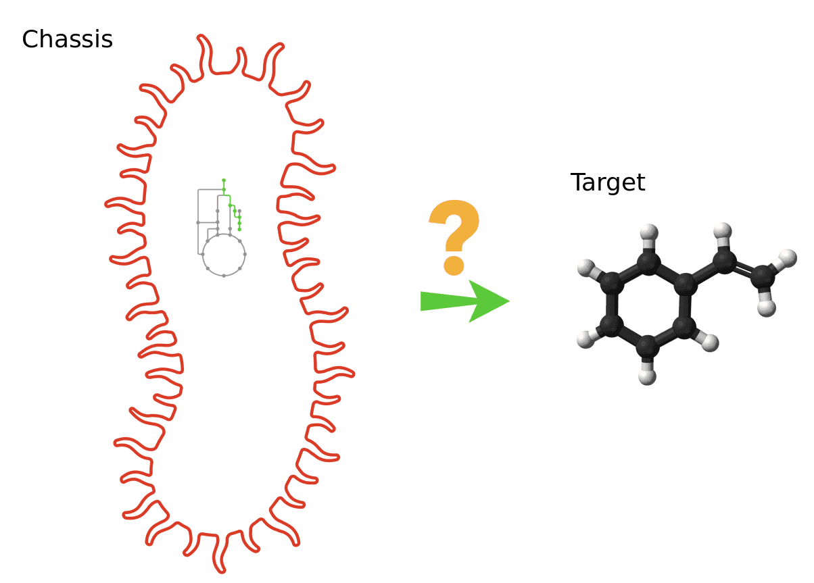
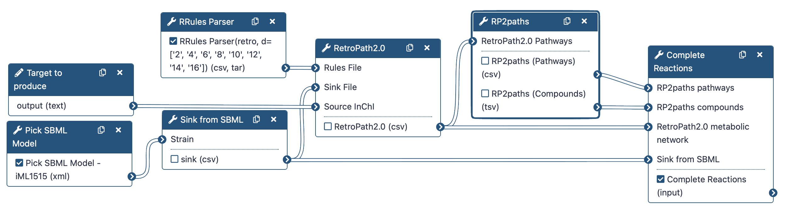
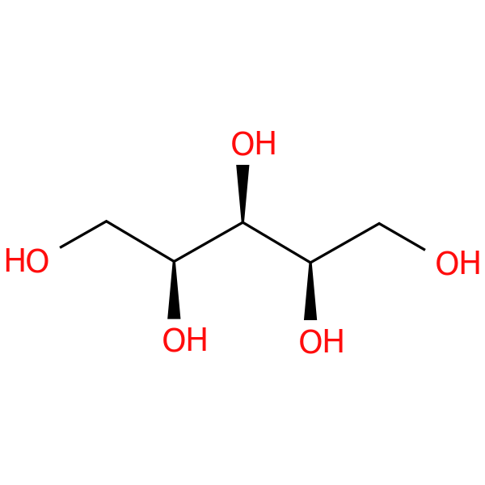

# Tutorial — Retro-Biosynthesis

Galaxy-SynBioCAD portal is the first toolshed for synthetic biology, metabolic engineering, and industrial biotechnology[@herisson2022]. It provides tools aimed at finding pathways to synthesize heterologous compounds in chassis organisms (RetroRules[@duigou2019], RetroPath2.0[@delepine2018], RP2Paths[@delepine2018], rpCompletion[@herisson2022]).

Retrosynthesis is a concept originally proposed for synthetic chemistry where chemists have to work backwards, starting from a target product to reach precursors that are endogenous to the chassis (host organism).

Typically, the target compound, also named “source compound” is the compound of interest one wishes to produce, while the precursors are usually compounds that are natively present in a chassis strain.

<figure class="numbered" markdown>
  { width="280" }
  <figcaption markdown>How to produce target from chassis?</figcaption>
</figure>

In this tutorial, we want to obtain the reactions producing the lycopene (source) into the iML1515 Escherichia Coli strain (chassis).

To do that, we will use the following RetroSynthetis Workflow composed of 3 key steps.

First, we aggregate the metabolites present in the chassis and download reaction rules.

Then, RetroPath2.0 generates feasible metabolic routes between a collection of chemical species contained within a GEM SBML (Systems Biology Markup Language) file of the selected organism, a target molecule that the user wishes to produce, and reaction rules extracted from RetroRules.

Lastly, the metabolic network is then deconstructed into individual pathways using RP2paths and rpCompletion takes those individual metabolic pathways to filter them (duplicated pathways are removed), splits them into sub-pathways by adding the appropriate cofactors, and finally converted them to SBML files.

Lastly, the metabolic network is then deconstructed into individual pathways using RP2paths and rpCompletion takes those individual metabolic pathways to filter them (duplicated pathways are removed), splits them into sub-pathways by adding the appropriate cofactors, and finally converted them to SBML files.

<figure class="numbered" markdown>
  { width="720" }
  <figcaption markdown>Retrosynthesis Workflow</figcaption>
</figure>

Note that we will run the steps of this workflow individually so as not to neglect the understanding of the intermediate steps as well. Then, we will run the workflow automatically so that it itself retrieves the outputs from the previous step and gives them as input to the next tool.

!!! tip "Before starting"
    - **Navigation**: Use the right sidebar to navigate through the tutorial.
    - **Tools**: Each tool is represented by its icon {{ icon("gx-tool") }} and version {{ icon("gx-tool-version") }}.
    - **Troubleshooting**: for issues using Galaxy please check the [Galaxy FAQ](https://training.galaxyproject.org/training-material/faqs/galaxy/).

## Data Preparation

RetroSynthesis workflow will be run with the following inputs:

  1. Chemical structure of the compound to produce, given by its InChI,
  2. Chemical structure of metabolites available in the chosen chassis (E. coli),
  3. Reaction rules modeling possible metabolic transformations.

!!! info "Targeted compound and chassis"
    In the course of this tutorial, we'll focus on the production of **xylitol** in an Escherichia Coli strain. To model the metabolism of this strain, we will use the *E. coli* core model available in the BiGG database[@king2016].

The data used are pretty straight forward to obtain. Firstly, we download an SBML model, then we select all sinks to use into the RetroPath2.0 software from this model. Lastly, we request from RetroRules all possible reactions to find a chemical reaction cascade that produces the target.

### Create a new history

!!! example "How-to: Create a new history"
    1. Click on the {{ icon("gx-new-history") }} icon, right panel (top of the history panel).
    2. Select **Create New**.
    3. Rename history to **`RetroSynthesis - Xylitol`** by clicking on its name (default is "Unnamed history").

    Source: [Creating a New History — Galaxy FAQ](https://training.galaxyproject.org/training-material/faqs/galaxy/#tip-creating-a-new-history)

    :material-alert: It is recommended to create a new history for each tutorial to avoid confusion with existing datasets.

### Metabolic model

!!! example "Hands-on: Acquire a SBML model"
    Run {{ icon("gx-tool") }}**Pick SBML Model** ({{ icon("gx-tool-version") }}Galaxy Version 0.0.3) with  parameter:

    - **Strain** {{ icon("gx-dropdown") }}: **`Escherichia coli str. K-12 substr. MG1655 (e_coli_core)`** <span style="color:#f59e0b">:material-alert:</span>
  
    ??? warning "Strain selection"
        Double check that the **`e_coli_core`** E. coli's model is selected.
        
        There are many strains related to *E. coli*. Here, we select the core model for simplicity and computational efficiency.

    ??? question "Q1: What is the BiGG database?"
        
        The BiGG Models database is a repository of genome-scale metabolic network reconstructions that provides standardized, high-quality models for various organisms, facilitating research in systems biology and metabolic engineering.
        
        ```text
        ```
        

    ??? question "Q2: Why using a SBML model?"
        
        SBML (Systems Biology Markup Language) is a widely used format for representing computational models in systems biology. It allows for the exchange and sharing of models between different software tools and platforms, making it easier to collaborate and reproduce results.
        
        ```text
        ```
        

    ??? question "Q3: How many files are generated? What are they?"
        
        4 files:
        - `e_coli_core`: the SBML model file (XML/SBML format)
        - `e_coli_core (taxon id)`: the NCBI taxonomy ID of the organism (TXT/TSV format)
        - `e_coli_core (compartments)`: the list of compartments in the model (TSV format)
        - `e_coli_core (biomass reactions)`: the list of biomass reactions in the model (TSV format)
        
        ```text
        ```
        

    ??? question "Q4: What is the file format of the model?"
        
        The model is in SBML format, which is based on XML.
        
        ```text
        ```
        

!!! example "Hands-on: Rename datasets"
    Rename output datasets of **Pick SBML Model**:

    | Current name                         | New name                         |
    |------------------------------------- |----------------------------------|
    | **`e_coli_core`**                    | **`Model - SBML`**               |
    | **`e_coli_core (taxon id)`**         | **`Model - Taxon ID`**           |
    | **`e_coli_core (compartments)`**     | **`Model - Compartments`**       |
    | **`e_coli_core (biomass reactions)`**| **`Model - Biomass Reactions`**  |

    ??? tip "How-to: Rename a dataset"
        1. Click on the {{ icon("gx-pencil") }} pencil icon for the dataset to edit its attributes
        2. In the central panel, change the **Name** field
        3. Click the **Save** button

        Source: [Renaming a Dataset — Galaxy FAQ](https://training.galaxyproject.org/training-material/faqs/galaxy/#tip-renaming-a-dataset)

### Sink compounds

!!! example "Hands-on: Create a sink file"

    Run {{ icon("gx-tool") }}**Sink from SBML** ({{ icon("gx-tool-version") }}Galaxy Version 5.12.1) with parameters:

    - **Strain**:
        - Select mode **Single dataset**: icon {{ icon("gx-param-file") }}
        - Select dataset {{ icon("gx-history-input") }}: **`Model - SBML`**
    - **SBML compartment ID**: **`c`**
    - **Advanced options {{ icon("gx-eye") }}**: dead-end metabolites removal using FVA

    ??? tip "How-to: Select a dataset by drag-and-drop"
        1. In the history panel, {{ icon("hand-pointer") }} click and hold the left mouse button on the desired dataset
        2. Drag and drop the dataset on top of the input field

    ??? question "Q1: What does this tool do?"
        
        This tool extracts all metabolites present in the SBML model and creates a sink file (CSV format) that can be used as input for RetroPath2.0.
        
        ```text
        ```
        

    ??? question "Q2: How many compounds are listed in the file?"
        
        52 compounds.
        
        ```text
        ```
        

    ??? question "Q3: What is FVA? How is it used here?"
        
        Flux Variability Analysis (FVA) is a computational method used to analyze the range of possible fluxes through metabolic reactions in a given metabolic network. It helps to identify reactions that can carry flux under specific conditions, such as growth on a particular substrate. In this context, FVA is used to remove dead-end metabolites from the sink file, ensuring that only metabolites that can be produced or consumed in the metabolic network are included.
        
        ```text
        ```
        

!!! info "Note: Compartment ID"
    The compartment ID must correspond to the one used in the SBML model. Here, **`c`** is the BiGG code for the cytoplasm. Other common compartment IDs are **`e`** for extracellular and **`p`** for periplasm.

    :material-alert: For SBML model from another source, this value must be adapted accordingly. Available compartments can be manually checked in the SBML file by searching for **`compartment id=`**.

!!! example "Hands-on: Rename dataset"
    Rename the output dataset of **Sink from SBML**:

    | Current name              | New name           |
    |-------------------------- |--------------------|
    | **`Sink - Model - SBML`** | **`Sink - Model`** |

### Reaction rules

!!! example "Hands-on: Download reaction rules"

    Run {{ icon("gx-tool") }}**RRules Parser** ({{ icon("gx-tool-version") }}Galaxy Version 2.6.0+galaxy0) with parameters:

    - Select **Rule Type** {{ icon("gx-dropdown") }}: **`RetroRules (retro)`**  
    - Select **diameters of reactions rules** {{ icon("gx-param-checkbox") }}: **`8`**, **`12`**
    - Toggle **Compress output** {{ icon("gx-param-toggle-off") }}: **`No`**
    - Filter by **EC number** {{ icon("gx-dropdown") }}: **`No`**

    ??? question "Q1: How a reaction rule differs from a regular reaction?"
        
        A regular reaction describes a specific chemical transformation between defined reactants and products, while a reaction rule is a generalized representation that captures the underlying transformation pattern. Reaction rules can be applied to a broader range of substrates, enabling the prediction of reactions for compounds that share similar structural features.
        
        ```text
        ```
        

    ??? question "Q2: What is a diameter in this context?"
        
        The diameter of a reaction rule defines the size of the molecular environment around the reaction center that is considered when applying the rule. It determines how specific or general the rule is, with larger diameters capturing more of the surrounding structure and thus being more specific.
        
        ```text
        ```
        

    ??? question "Q3: What is the impact of choosing low or high diameters?"
        
        Choosing low diameters results in more general rules that can be applied to a wider range of substrates, leading to more potential reactions, but may also lead to less accurate predictions. Conversely, higher diameters yield more specific rules that are tailored to particular substrates, potentially improving accuracy but limiting applicability.
        
        ```text
        ```
        

    ??? question "Q4: What is the format of the output file?"
        
        The output file is in CSV format and contains information about the predicted reactions, including reactants, products, and their associated SMILES and InChI representations.
        
        ```text
        ```
        
    
    ??? question "Q5: Where is located the encoding of the reaction rules?"
        
        The encoding of the reaction rules is located in the **`Rule`** column.
        
        ```text
        ```
        

    ??? question "Q6: How many rules have been downloaded?"
        
        58,596 rows.
        
        ```text
        ```
        

!!! example "Hands-on: Rename dataset"
    Rename the outputed dataset of **`RRules Parser`** to **`Reaction Rules`**.

## Retrosynthesis

### Run algorithm using **RetroPath2.0**

RetroPath2.0 is an open-source tool for building retrosynthesis networks by combining reaction rules and a retrosynthesis-based algorithm to link the desired target compound to a set of available precursors. RetroPath2.0 core code is available at [myExperiment](https://www.myexperiment.org/workflows/4987.html).

The retrosynthesis network is outputted as a CSV file listing predicted reactions and chemicals (provided as SMILES and InChI) along with other information like a penality score for each reaction.

!!! example "Hands-on: Build a reaction network"
    Run {{ icon("gx-tool") }}**RetroPath2.0** ({{ icon("gx-tool-version") }}Galaxy Version 2.3.0) with the following parameters:

    - Select **Rules File**:
        - **Single dataset** input {{ icon("gx-param-file") }}
        - Dataset {{ icon("gx-history-input") }} **`Reaction Rules`**
    - Select **Sink File**:
        - **Single dataset** input {{ icon("gx-param-file") }}
        - Dataset {{ icon("gx-history-input") }} **`Sink - Model`**
    - Select **Target Compound**:
        - **InChI type** {{ icon("gx-dropdown") }} By string
        - **Source InChI** {{ icon("gx-param-text") }}: **`InChI=1S/C5H12O5/c6-1-3(8)5(10)4(9)2-7/h3-10H,1-2H2/t3-,4+,5+`** <span style="color:#f59e0b">:material-alert:</span>
    - **Maximal Pathway length** {{ icon("sliders") }} **`2`**
    - **Advanced options {{ icon("gx-eye") }}**: leave default values

    ??? warning "InChI format"
        Be careful, InChI must start by `InChI=`.

    ??? question "Q1: What is Xylitol? What does it look like? Where to find more information?"
        
        Xylitol is a natural sugar alcohol used as a sweetener in various food products, and it has applications in dental care due to its ability to reduce tooth decay. More information can be found on its [PubChem entry](https://pubchem.ncbi.nlm.nih.gov/compound/Xylitol).

        <figure class="numbered" markdown>
          { width="200" }
          <figcaption markdown>Xylitol chemical structure.</figcaption>
        </figure>
        
        ```text
        ```
        
    
    ??? question "Q2: What is the purpose of the sink file?"
        
        The sink file lists metabolites that are available in the chassis organism (E. coli in this case). It is used to determine which predicted compounds are available materials for biosynthesis. Once a predicted compound is found in the sink, retrosynthesis process stops for that branch.
        
        ```text
        ```
        

    ??? question "Q3: How many iterations of the retrosynthesis were performed?"
        
        2 iterations maximum.
        
        ```text
        ```
        

    ??? question "Q4: What is the format of input and output files?"
        
        - Reaction rules: CSV file
        - Sink: CSV file
        - Output: CSV file
        
        ```text
        ```
        

    ??? question "Q5: How many reactions are predicted?"
        
        37 rows.
        
        ```text
        ```
        

!!! info "Note: Execution time"
    Depending on the number of rules and the target compound, the execution time may vary from a few minutes to several hours.

!!! example "Hands-on: Rename dataset"
    Rename the output dataset of **`RetroPath2.0`** to **`Retrosynthesis Network`**.

### Enumerate pathways with **RP2paths**

The RetroPath2.0 algorithm produces a reaction network, exploring reachable compounds and reactions starting from the target compound.

Here, we will investigate how to split this network into individual pathways. A pathway is considered valid if it starts from only available material (sink metabolites) and reaches the target.

!!! example "Hands-on: Enumerate pathways"

    Run {{ icon("gx-tool") }}**RP2paths** ({{ icon("gx-tool-version") }}Galaxy Version 1.5.0) with parameters:

    - Select **RetroPath2.0 Pathways**:
        - **Single dataset** input {{ icon("gx-param-file") }}
        - Dataset {{ icon("gx-history-input") }} **`Retrosynthesis Network`** (output of **RetroPath2.0**)
    - **Advanced options {{ icon("gx-eye") }}**: leave default values

    ??? question "Q1: How many files are produced? What are they?"
        
        2 files:
        - **Compounds**: CSV file listing all compounds involved in the pathways, with their SMILES representations.
        - **Pathways**: CSV file listing all identified pathways, with pathway IDs, reactions equations, and compounds IDs.
        
        ```text
        ```
        
    
    ??? question "Q2: What is the formalism used for the structure of compounds? How could it be visualized?"
        
        The compounds are represented using SMILES (Simplified Molecular Input Line Entry System) notation. SMILES strings can be visualized using various cheminformatics tools and libraries, such as RDKit, or online SMILES viewers, e.g. [PDB Chemical Sketch Tool](https://www.rcsb.org/chemical-sketch).
        
        ```text
        ```
        

    ??? question "Q3: How many pathways are found?"
        
        Path IDs range from 1 to 12: 12 pathways.
        
        ```text
        ```
        

    ??? question "Q4: Why is several rows per pathway?"
        
        Each pathway is represented by multiple rows, with each row corresponding to a reaction within the pathway.
        
        ```text
        ```
        

!!! example "Hands-on: Rename datasets"
    Rename the output datasets of **RP2paths**:

    | Current name                    | New name                          |
    |---------------------------------|-----------------------------------|
    | **`RP2paths (Compounds)`**      | **`Master pathways - Compounds`** |
    | **`RP2paths (Pathways)`**       | **`Master pathways`**             |

### Complete Reactions

Reaction rules are often generic, meaning that one rule can correspond to several template reactions. In addition, some compounds are excluded from the rules, on the left side notable as only one substrate is considered at a time. 

Here the aim is to build complete reactions, with all substrates and products, and to convert pathways into SBML files. Each "Master pathway" will be completed. In addition, if it can model several reactions, multiple pathways will be generated from one "Master pathway".

!!! example "Hands-on: Complete reactions"
    Run {{ icon("gx-tool") }}**Complete Reactions** ({{ icon("gx-tool-version") }}Galaxy Version 5.12.2) with parameters:

    - Select **RP2paths pathways**:
        - **Single dataset** input {{ icon("gx-param-file") }}
        - Dataset {{ icon("gx-history-input") }} **`Master pathways`**
    - Select **RP2paths compounds**:
        - **Single dataset** input {{ icon("gx-param-file") }}
        - Dataset {{ icon("gx-history-input") }} **`Master pathways - Compounds`**
    - Select **RetroPath2.0 metabolic network**:
        - **Single dataset** input {{ icon("gx-param-file") }}
        - Dataset {{ icon("gx-history-input") }} **`Retrosynthesis Network`** (output of RetroPath2.0)
    - Select **Sink from SBML**:
        - **Single dataset** input {{ icon("gx-param-file") }}
        - Dataset {{ icon("gx-history-input") }} **`Sink - Model`**
    - **Advanced options {{ icon("gx-eye") }}**: leave default values.

    ??? question "Q1: What is the format of the output?"
        
        A collection of SBML files, with one file per pathway.
        
        ```text
        ```
        

    ??? question "Q2: What is the benefit of this format?"
        
        SBML is a standard format for representing computational models in systems biology, allowing for easy sharing and analysis of biological pathways. It is widely supported by various software tools and platforms, facilitating collaboration and reproducibility in research.
        
        ```text
        ```
        

    ??? question "Q3: How many pathways have been generated?"
        
        10.
        
        ```text
        ```
        

    ??? question "Q4: Do these pathways represent a good solution?"
        
        We don't know if they represent a good solution. We need to evaluate them.
        
        ```text
        ```
        

!!! example "Hands-on: Rename collection"
    Rename the output dataset of **`Complete Reactions`** to **`Completed Pathways`**:

    1. **Click** on the collection to open it.
    2. **Click** on collection name itself (a tooltip appears: "Click to rename..").
    3. Enter the new name then press **Enter**.
    4. Refresh the history panel by clicking on the {{ icon("gx-refresh-history") }} icon (top right).

## Visualize pathways

!!! example "Hands-on: Visualize pathways"
    Run {{ icon("gx-tool") }}**Visualize pathways** ({{ icon("gx-tool-version") }}Galaxy Version 6.5.0+galaxy0) with parameters:

    - Select **Source SBMLs format** {{ icon("gx-dropdown") }}: **`Collection`**
    - Select **Source SBML** {{ icon("gx-history-input") }}: **`Completed Pathways`** <span style="color:#f59e0b">:material-alert:</span> Drag and drop from history to select the collection.
    - **Advanced options {{ icon("gx-eye") }}**: leave default values
  
    !!! warning "View the output"
        - Click on the {{ icon("gx-eye") }} icon of the output dataset **`Pathway Visualization`** to open it.
        - Alternatively (1): right-click on the {{ icon("gx-eye") }} icon and select **Open in new tab** to open it in a new browser tab.
        - Alternatively (2): click on the {{ icon("gx-download") }} icon and select **Download** to download the file and open it locally with a web browser. 

    ??? question "Q1: What is the format of the output?"
        
        The output is in HTML format, which can be viewed in a web browser.
        
        ```text
        ```
        

    ??? question "Q2: How many pathways are visualized?"
        
        10 pathways.
        
        ```text
        ```
        

    ??? question "Q3: What are possible panels of information?"
        
        - Pathway-related information panel (by click on a pathway ID)
        - Reaction-related information panel (by click on a reaction node)
        - Compound-related information panel (by click on a compound node)
        
        ```text
        ```
        

    ??? question "Q4: Do you see any common reactions between the different pathways?"
        
        Yes, some reactions are common between different pathways.
        
        ```text
        ```
        

    ??? question "Q5: Some reactions look identical, but have different IDs. Why?"
        
        They are actually different reactions because they involved different set of co-factors.
        
        ```text
        ```
        

    ??? question "Q6: Can you identify any key intermediates in the pathways?"
        
        Yes, some intermediates appear in multiple pathways, indicating their importance in the overall metabolic network.
        
        ```text
        ```
        

## Conclusion

In this tutorial we produced candidates pathways to produce Xylitol in an Esherichia Coli strain.

Four main steps were involved:

1. Pre-processing input data
2. Run Retrosynthesis algorithm with RetroPath2.0
3. Enumerate all solutions found by RetroPath2.0
4. Complete reactions and convert pathways to SBML files

## References

\bibliography
