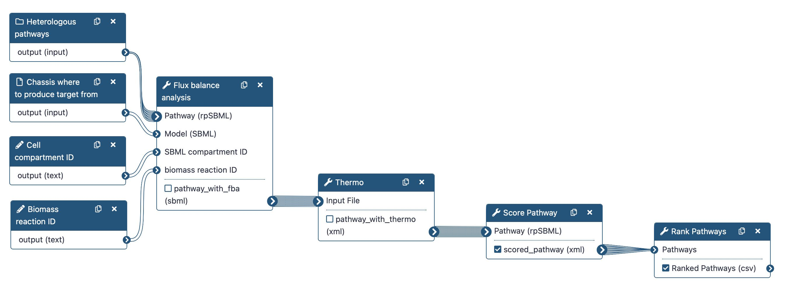
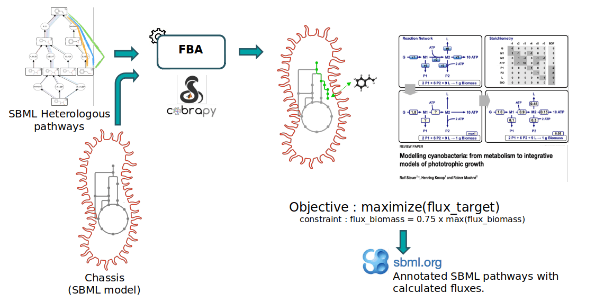
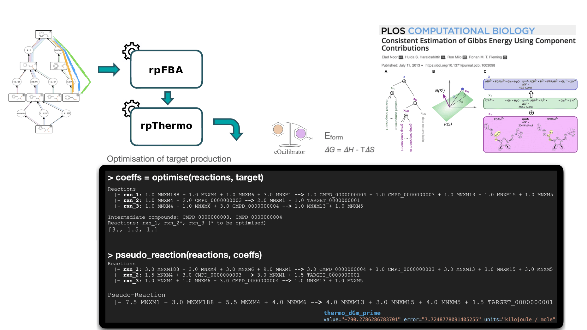
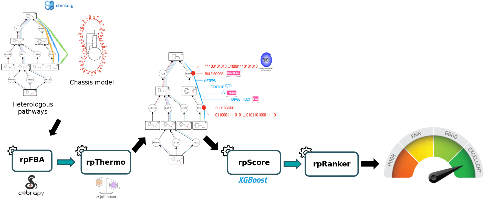

# Tutorial — Pathway Design

Progress in synthetic biology is enabled by powerful bioinformatics tools such as those aimed to design metabolic pathways for the production of chemicals. These tools are available in SynBioCAD portal which is the first Galaxy set of tools for synthetic biology and metabolic engineering[@herisson2022].

In this tutorial, we will use a set of tools from the **Pathway Analysis workflow** which will enable you to evaluate a set of heterologous pathways previously produced by the RetroSynthesis workflow in a chassis organism (_E. coli_). These tools are available in the [Galaxy SynbioCAD platform](https://galaxy-synbiocad.org).

Here we will identify the theoretically best performing pathways by ranking them based on the four following criteria: target product flux, thermodynamic feasibility, pathway length and enzyme availability.

We recommend that you follow the Retrosynthesis tutorial before starting the current tutorial which will enable you to find pathways to synthesize a target compound with _E. coli_.

Four main steps will be run using the following workflow:

1. To rank the computed heterologous pathways, we need to calculate some metrics. This is why an in-house Flux Balance Analysis (FBA) was developed to calculate the production flux of a given target (e.g. xylotol, lycopene, ...). The method forces a fraction of its maximal flux through the biomass reaction while optimizing for the target molecule. This is achieved by the _Flux Balance Analysis_ tool.

2. The _Thermo_ tool is used to estimate thermodynamics values (based on Gibbs free energies) for each pathway to know whether a producing pathway is feasible in physiological conditions. The contribution of individual reactions to the final pathway thermodynamic is balanced solving a linear equation system.

3. The _Score Pathway_ tool is used to calculate a global score combining target flux, pathway thermodynamics, pathway length and enzyme availability.

4. Pathways are ranked based on the global score using the _Rank Pathways_ tool.

<figure class="numbered" markdown>
  { width="720" }
  <figcaption markdown>The Pathway Analysis Workflow</figcaption>
  <!-- <figcaption markdown>Figure 1 — The *Pathway Analysis* Workflow viewed from the Galaxy editor interface. The pathway analysis workflow will evaluate and rank pathways based on multiple metrics. First, Flux Balance Analysis (FBA) node will take as inputs a collection of SBMLs representing the heterologous pathways to be evaluated, another SBML representing the chassis, and 2 additional inputs are expected for indicating the biomass reaction ID and the cell compartment ID that will be used during the FBA analysis. The FBA method will optimize the production of the target under the constraint that the model should still produce some level biomass. Then, the Thermo tool is used to estimate thermodynamics values for each pathway to know whether it is favorable towards target production in physiological conditions. After that the Score Pathway tool will calculate a global score combining target flux, pathway thermodynamics, pathway length and enzyme availability. Finally, the pathways are ranked based on the global score using the Rank Pathways tool. All exchange files are SBMLs. The output is a CSV file which contains the pathway IDs and their corresponding global score.</figcaption> -->
</figure>

!!! tip "Before starting"
    - **Navigation**: Use the right sidebar to navigate through the tutorial.
    - **Tools**: Each tool is represented by its icon {{ icon("gx-tool") }} and version {{ icon("gx-tool-version") }}.
    - **Troubleshooting**: for issues using Galaxy please check the [Galaxy FAQ](https://training.galaxyproject.org/training-material/faqs/galaxy/).
    - **Galaxy FAQ**: web page is long, use your browser search function (Ctrl+F or Cmd+F) to find relevant topics.

## Data Preparation

The input data required are:

- A **collection of pathways provided as SBML** such as those outputted by the RetroSynthesis workflow.

- A **metabolic model** of the chassis organism (e.g. _E. coli_), provided as an SBML file.

!!! info "Targeted compound and chassis"
    In the course of this tutorial, we will focus on the bioproduction of **xylitol** in an Escherichia Coli strain.

    The **pathways to investigate were obtained from the Retrosynthesis tutorial**, and the chassis organism is modeled by the **_E. coli_ core model** (obtained from the BiGG database[@king2016]).

### Create a new history

!!! example "Hands-on: Create a new history"

    Create a new history named **`Pathway Analysis - Xylitol`** by following [Creating a new history — Galaxy FAQ](https://training.galaxyproject.org/training-material/faqs/galaxy/#tip-creating-a-new-history).

### Add pathways and model files

!!! example "Hands-on: Add pathways and model files"

    === "Option 1: Upload from URLs"
        1. Import pathways files from the online resources:

            ```
            https://raw.githubusercontent.com/tduigou/galaxy-synbiocad-tutos/refs/heads/main/data/pa-inputs/rp_002_0001.xml
            https://raw.githubusercontent.com/tduigou/galaxy-synbiocad-tutos/refs/heads/main/data/pa-inputs/rp_004_0001.xml
            https://raw.githubusercontent.com/tduigou/galaxy-synbiocad-tutos/refs/heads/main/data/pa-inputs/rp_005_0001.xml
            https://raw.githubusercontent.com/tduigou/galaxy-synbiocad-tutos/refs/heads/main/data/pa-inputs/rp_007_0001.xml
            ```

            ??? tip "How-to: Importing via links"
                - Copy link(s) to clipboard
                - Click {{ icon("gx-upload") }}**Upload Data** at the top of the tool panel
                - Select {{ icon("gx-edit") }}**Paste/Fetch Data**
                - Paste link(s) into text field
                - Click **Start**
                - **Close** the window

                More details: [Import via Link — Galaxy FAQ](https://training.galaxyproject.org/training-material/faqs/galaxy/#tip-importing-via-links)

        2. Create a collection (list) named **`Predicted Pathways`** and containing the SBML pathways. <span style="color:#f59e0b">:material-alert:</span> **Do not** include the model file.
        
            ??? tip "How-to: Creating a dataset collection"
                See: [Creating a dataset collection — Galaxy FAQ](https://training.galaxyproject.org/training-material/faqs/galaxy/#tip-creating-a-dataset-collection)

        2. Import model file:

            ```
            https://raw.githubusercontent.com/tduigou/galaxy-synbiocad-tutos/refs/heads/main/data/pa-inputs/e_coli_core.xml
            ```
        
        3. Rename the _E. coli_ model to **`Model - SBML`**.

<!-- === "Option 2: Copy from previous history"
    Copy the pathways and model from the history used in the Retrosynthesis tutorial.

    ??? tip "Copying datasets between histories"
        1. Click on the gear icon which is on the top of the list of datasets in the history panel
        2. Click on **Copy Datasets**
        3. Select the source history (the one used in the Retrosynthesis tutorial)
        4. Select the desired files to copy
        5. Select the goal history (the current history one _Pathway Analysis_)
        6. Validate by ‘Copy History Items’

        More details: [Copy Datasets Between Histories — Galaxy FAQ](https://training.galaxyproject.org/training-material/faqs/galaxy/#tip-copy-a-dataset-between-histories) -->

## Pathway Analysis

### Estimate production flux

Notice that the starting compounds (in other words, _the precursors_) of the predicted pathways (also referred as the _heterologous pathways_) are compounds that have been initially extracted from the genome-scale metabolic model (GEM) of the organism we are interested in (also referred as _chassis_). While this step is out of the scope of the present Pathway Analysis tutorial, this means that the precursors of predicted pathways are also present in the chassis model. Hence, predicted pathways and the chassis organism model can be merged to construct "augmented" whole-cell models, enabling flux analysis of these metabolic systems. This is what we'll do here to predict the production flux of a compound of interest.

Within the frame of this tutorial, we'll use _E. coli_ ecoli_core GEM (downloaded from the [BiGG database](http://bigg.ucsd.edu/)) to model the metabolism of _E. coli_ and target is xylitol. The extraction of precursor compounds and the pathway prediction have already been performed during the RetroSynthesis workflow (available in [Galaxy SynbioCAD platform](https://galaxy-synbiocad.org)).

The FBA (Flux Balance Analysis) method used to calculate the flux is a mathematical approach (as decribed in section Methods[@herisson2022]) which uses the COBRApy package[@ebrahim2013] and proposes 3 different analysis methods (standard FBA, parsimonious FBA, fraction of reaction). The first two methods are specific to the COBRApy package and the last one `Fraction of Reaction` is an in-house analysis method to consider the cell needs for its own maintenance while producing the target compound.

Within the workflow, the purpose of the _Flux Balance Analysis_ tool is to predict the production flux of the targeted compound, while considering the cellular needs. Under such simulation conditions, the analysis that returns a low production flux may be due to some precursor compounds having a limiting production flux, nor cofactor fluxes involved not being sufficiently balanced by the chassis native metabolism. Pathways with high flux would be caused by both the precursor compounds and the cofactors being in abundance. In either case, bottlenecks that limit the flux of the pathway may be investigated (this is outside of the scope of the workflow) and pathways that do not theoretically generate high yields can be filtered out.

We first perform an FBA (with COBRApy) optimizing the biomass reaction and record its maximal theoretical flux. The upper and lower bounds of the biomass reaction are then set to a same amount, equals to a fraction of its previously recorded optimum (default is 75% of its optimum). The method then performs a second FBA where biomass flux is enforced to this fraction of its optimum while optimizing the target production flux. Simulated fluxes are recorded directly into the SBML file and all changed flux bounds are reset to their original values before saving the output file.

<figure class="numbered" markdown>
  { width="720" }
  <figcaption markdown>Flux Balance Analysis (FBA) workflow for pathway analysis.</figcaption>
  <!-- <figcaption markdown>Figure 2 — This picture describes the process to obtain annotated SBML pathways with calculated fluxes. First, FBA tool takes as input one SBML representing the heterologous pathway and another SBML representing the chassis. The two SBMLs are merged to render an augmented model containing both the reactions of the heterologous pathway and the chassis. Then FBA tool uses the COBRApy package to optimize the producing flux of the target reaction, under the constraint that the flux of the biomass reaction should be equals to 75% of its maximal theoretical value. At the end, the calculated fluxes are recorded as annotations into the SBML of the heterologous pathway.</figcaption> -->
</figure>

!!! info "Note"
    Blocking compounds that cannot provide any flux are temporarily removed from heterologous reactions for the FBA evaluation. Such cases can happen due to side substrates or products of predicted reactions that do not match any chassis compound, representing dead-end paths.

!!! example "Hands-on: Flux Balance Analysis"
    Run {{ icon("gx-tool") }}**Flux balance analysis** ({{ icon("gx-tool-version") }}Galaxy Version 6.5.0+galaxy0) with parameters:

    - Select **Pathway(s)**:
        - **Dataset collection** input type {{ icon("gx-param-collection") }} <span style="color:#f59e0b">:material-alert:</span> Double check input type
        - Dataset {{ icon("gx-history-input") }} **`Predicted Pathways`**
    - Select **Model**:
        - **Single dataset** input type {{ icon("gx-param-file") }}
        - Dataset {{ icon("gx-history-input") }} **`Model - SBML`**
    - **SBML compartment ID**: **`c`**.
    - **Reaction ID to optimise**: **`rxn_target`**
    - **Biomass reaction ID**: use **`R_BIOMASS_Ecoli_core_w_GAM`**.
    - **Constraint based simulation type**: select **`Fraction of Reaction`**
    - **Advanced options {{ icon("gx-eye") }}**: leave default values

    ??? question "Q1: What are the format and the extension of the output files ?"
        1. The output is an SBML file with `.xml` extension.
   
    ??? question "Q2: What is the FBA score for **`rp_002_0001`** pathway ? {{ icon("warning") }}difficult"
        2. Click on the output collection to expand it and see the list of SBML files.
        3. Click {{ icon("gx-eye") }} to open the file **`rp_002_0001`**.
        4. Search (Ctrl+F or Cmd+F) for **`fba_fraction`** within a **`<groups:listOfGroups>`** section.
        5. The value is ~ **`2.48..`**.

    ??? question "Q3: What does the FBA score represent ?"
        The FBA score represents the production flux of the target compound (here xylitol) when the biomass flux is constrained to 75% of its maximal theoretical value.

    ??? info "Compartment ID"
        You can specify the compartment from which the chemical species were extracted. The default is **`c`**, the BiGG code for the cytoplasm.
    
    ??? info "Reaction ID to optimise"
        The reaction ID to optimize is the reaction producing the target compound within each SBML. It is named **`rxn_target`** in the SBMLs produced by the RetroSynthesis workflow. For SBMLs from other sources, check the reaction ID of the reaction producing the target compound and use it as input.

    ??? info "Biomass reaction ID"
        The biomass reaction ID objective stands for the **`e_coli_core`** model. For other models, one can search in the model the term **`biomass`** and pick the corresponding ID.

!!! example "Hands-on: Rename the output collection"
    Rename the output collection to **`FBA - Annotated Pathways`**.

### Estimate thermodynamics

The goal of the thermodynamic analysis is to estimate the feasibility of the predicted pathways toward target production, in physiological conditions. The eQuilibrator libraries[@beber2021] are used to calculate the formation energy of compounds by either using public database IDs (when referenced within the tools internal database) or by decomposing the chemical structure and calculating its energy of formation using the component contribution method.

The reaction Gibbs energy is estimated by combining the energy of formation of the compounds involved in the reaction (with consideration for the stoichiometric coefficients).

Thermodynamic of a pathway is estimated by combining the Gibbs energy of reactions involved in it. The contribution of individual reactions to the final pathway thermodynamic is balanced using a linear equation system, according to the relative uses of intermediate compounds across the pathway (See Thermodynamics in Methods section for further details[@herisson2022]. A pathway Gibbs energy below zero indicates that the thermodynamic is favorable toward the production of the target.

The _Thermo_ Galaxy tool is used to estimate thermodynamics values (based on Gibbs free energies) for each pathway to know whether a producing pathway is feasible in physiological conditions

<figure class="numbered" markdown>
  { width="720" }
  <figcaption markdown>Thermodynamic Analysis concepts.</figcaption>
  <!-- ![This image describe the process of computing thermodynamics values of a pathway, to assess whether a pathway is favorable towards target production in physiological conditions. rpThermo tool takes as input the output of rpFBA, which corresponds to the pathway to be analyzed (as an SBML file). rpThermo relies on eQuilibrator libraries to calculate the formation energy of compounds. The reaction Gibbs energy is estimated by combining the energy of formation of the compounds involved in the reaction (with consideration for the stoichiometric coefficients). From this, the thermodynamic of a pathway is estimated by combining the Gibbs energy of all reactions taking part in it. The individual contribution of reactions to the final pathway thermodynamic is weighted using a linear equation system, to take into consideration of the relative needs of intermediate compounds across the pathway. For the record, a pathway Gibbs energy below zero indicates that the thermodynamic is favorable toward the production of the target.](../../images/rpthermo.png) -->
</figure>

!!! example "Hands-on: Estimate Thermodynamics"

    Because the _Thermo_ tool is resource-intensive and will be time-consuming, **Option 1** has to be used during this tutorial — **Option 2** is provided for information but {{ icon("warning") }} **do not** run it today {{ icon("warning") }}.

    === "{{ icon("thumbs-up") }} Option 1: Download pre-computed results"

        1. Download the pre-computed results on your computer: [Thermo - FBA - Annotated pathways.zip](https://github.com/tduigou/galaxy-synbiocad-tutos/raw/refs/heads/main/data/pa-thermo/Thermo - FBA - Annotated pathways.zip)

        2. Unzip the file (locally on your computer).

        3. Upload the unzipped file to your current history:

            - Click on {{ icon("gx-upload") }}**Upload Data** at the top of the tool panel
            - Select {{ icon("laptop") }}**Choose local files**
            - Select all files from unzipped folder (hold Shift key to select multiple files)
            - Click **Start**
            - **Close** the window

        4. Create a collection (list) named **`Thermo - FBA - Annotated Pathways`** and containing the SBML pathways.
        <span style="color:#f59e0b">:material-alert:</span> **Do not** include other files. <span style="color:#f59e0b">:material-alert:</span>

        ??? question "Q1: What is the thermodynamic value for the reaction with _EC number_ 1.1.1.307 for **`rp_002_0001`** pathway?"
            1. Use the {{ icon("gx-tool") }}**Visualize Pathway** tool to generate a graphical representation of all pathways.
            2. Click on **`1.1.1.307`** reaction belonging to the **`rp_002_0001`**.
            3. On the right panel, look for the ΔrG' (standard Gibbs free energy change) value
            4. The value is **`-2.258`** kJ/mol.

        ??? question "Q2: What a negative ΔrG' indicates?"
            A negative value indicates that the reaction is favorable in physiological conditions, hence it will proceed spontaneously in the forward direction.

    === "{{ icon("warning") }} Option 2: Run Thermo tool — time-consuming"

        Run {{ icon("gx-tool") }}**Thermo** ({{ icon("gx-version") }}Galaxy Version 6.5.0+galaxy0) with parameters:

        - Select **Pathway(s)**:
            - **Dataset collection** input type {{ icon("gx-param-collection") }} <span style="color:#f59e0b">:material-alert:</span> Double check input type
            - Dataset {{ icon("gx-history-input") }} **`FBA - Annotated Pathways`**
        - **Advanced options {{ icon("gx-eye") }}**: leave default values

        !!! comment "Note"
            The tool takes as input pathways in SBML format and returns annotated pathways (with thermodynamics information for each reaction) in SBML format too.

!!! example "Hands-on: Rename the output collection"
    It not set yet, rename the output collection to **`Thermo - FBA - Annotated Pathways`**.

### Estimate global scores

The _Pathway Score_ tool provides a global score for a given pathway previously annotated by the _Flux Balance Analysis_ and _Thermo_ tools. This score is computed by a machine learning (ML) model (cf. Machine Learning Global Scoring[@herisson2022]. The model takes as input features describing the pathway (thermodynamic feasibility, target flux with fixed biomass, length) and the reactions within the pathway (reaction SMARTS, Gibbs free energy, enzyme availability score) and prints out the probability for the pathway to be a valid pathway. The ML model has been trained on literature data (cf. section Benchmarking with literature data[@herisson2022]) and by a validation trial (cf. section Benchmarking by expert validation trial[@herisson2022]).

<figure class="numbered" markdown>
  { width="720" }
  <figcaption markdown>Pathway Score estimation concepts.</figcaption>
  <!-- ![This scheme represents the pathway analysis workflow enabling the identification of the best pathways for producing a molecule of interest. To do that the workflow takes as input the collection of pathways to be scored and the metabolic model of the chassis (all files are SBMLs). Iteratively, each pathway is merged with the chassis model, and several metrics are evaluated such as the target production flux (using the rpFBA tool) and the thermodynamics of the pathway (using the rpThermo tool). A global score of each pathway combining these metrics with others is computed using a machine learning method (with the rpScore tool). Finally, the pathways are ranked from best to worst according to their global score (using the rpRanker tool). During the workflow, all metrics are stored as SBML annotations. The final output is a CSV file which contains the pathway IDs and their corresponding global score.](../../images/pathway_analysis_scheme.png) -->
</figure>

!!! example "Hands-on: Score Pathways"
    Run **Score Pathway** (Galaxy Version 6.5.0+galaxy0) with parameters:

    - **Pathway(s)**:
        - **Dataset collection** input type {{ icon("gx-param-collection") }} <span style="color:#f59e0b">:material-alert:</span> Double check input type
        - Dataset {{ icon("gx-history-input") }} **`Thermo - FBA - Annotated Pathways`**
    - **Advanced options {{ icon("gx-eye") }}**: leave default values

    !!! comment "Outputted files"
        The tool outputs new annotated SBML files representing the pathways, containing the `global_score` annotation, as well as other annotations such as the FBA score and the pathway Gibbs energy.

    ??? question "Q1: What does the computed score represent?"
        The computed score represents the probability for the pathway to be a valid pathway.

!!! example "Hands-on: Rename the output collection"
    It not set yet, rename the output collection to **`Scored - Thermo - FBA - Annotated Pathways`**.

## Visualize pathways

!!! example "Hands-on: Visualize pathways"
    Run {{ icon("gx-tool") }}**Visualize pathways** ({{ icon("gx-tool-version") }}Galaxy Version 6.5.0+galaxy0) with parameters:

    - Select **Source SBMLs format** {{ icon("gx-dropdown") }}: **`Collection`**
    - Select **Source SBML** {{ icon("gx-history-input") }}: **`Scored - Thermo - FBA - Annotated Pathways`**
    - **Advanced options {{ icon("gx-eye") }}**: leave default values
  
    !!! warning "View the output"
        - Click on the {{ icon("gx-eye") }} icon of the output dataset **`Pathway Visualization`** to open it.
        - Alternatively (1): right-click on the {{ icon("gx-eye") }} icon and select **Open in new tab** to open it in a new browser tab.
        - Alternatively (2): click on the {{ icon("gx-download") }} icon and select **Download** to download the file and open it locally with a web browser. 

    ??? question "Q1: How many pathways are visualized?"
        There are 4 pathways.
    
    ??? question "Q2: What is the global score of the pathway `rp_002_0001`?"
        1. Click on the pathway `rp_002_0001` to open it.
        2. On the left panel, look for the "Info" icon and click on it.
        3. On the right panel, look for the `Global score` section.
        4. The value is **`0.974`**.
   
    ??? question "Q3: What is the best pathway?"
        The best pathway is `rp_002_0001` with a global score of **`0.974`**.

    ??? question "Q4: What is the FBA score of the best pathway?"
        The FBA score of the best pathway `rp_002_0001` is **`2.484`**.

<!-- ### Rank annotated pathways

Finally, _Rank Pathways_ ranks the previous set of heterologous pathways, based on their global score, to reveal what are the most likely pathways to produce the target molecule (here it is _lycopene_) in a given organism of interest (_E. coli_ in this tutorial).

!!! example "Hands-on: Rank pathways"

    Run **Rank Pathways** (Galaxy Version 6.5.0+galaxy0) with the following parameters:
        - **Pathways**: Select the output of the previous **Score Pathway** step.

!!! comment "Note"
    This tool will output a CSV file which contains the pathway IDs and their corresponding global score.

??? question "Q1: What are the 3 top-ranked pathways?"
    View the output CSV file and sort the table by the `global_score` column (click on the column header). The top 3 pathways are `rp_002_0001`, `rp_004_0001` and `rp_005_0001`. -->

## Conclusion

To select the best pathways for producing the Xylitol in _E. coli_, some metrics have been estimated, namely production flux of the target, pathway thermodynamics. Global score estimation relies on these criteria plus the pathway length and the enzyme availability score using a machine learning model.

The best pathway for producing Xylitol in _E. coli_ is **`rp_002_0001`** with a global score of **`0.974`**. Further investigations should be performed such as identifying potential enzyme sequences for the reactions, codon optimization, DNA synthesis and assembly to finally express the pathway in the chassis organism.

## License

Attributions: Thomas Duigou, Kenza Bazi-Kabbaj, Guillaume Gricourt, Joan Hérisson, Ioana Popescu, Jean-Loup Faulon.

This tutorial is licensed under [CC BY 4.0](https://creativecommons.org/licenses/by/4.0/).


## References

\bibliography
