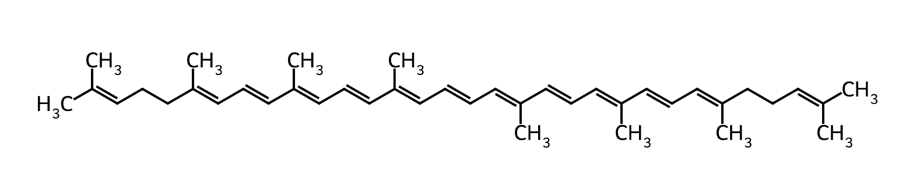
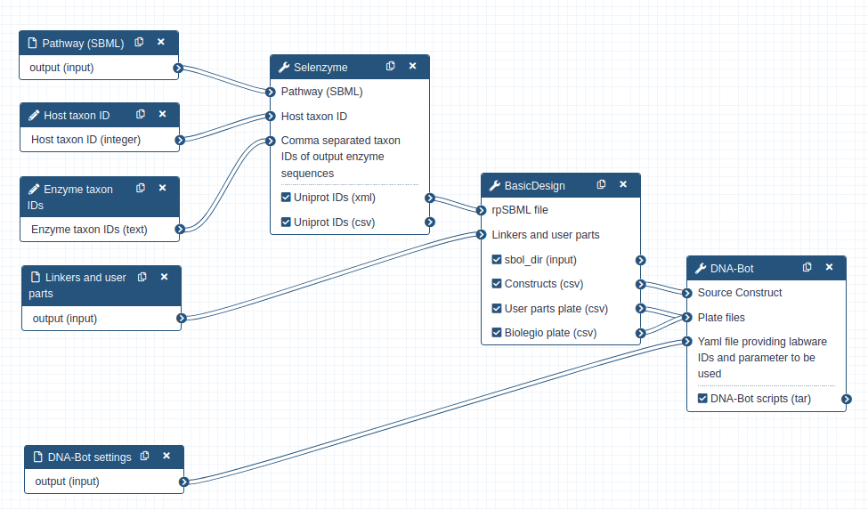
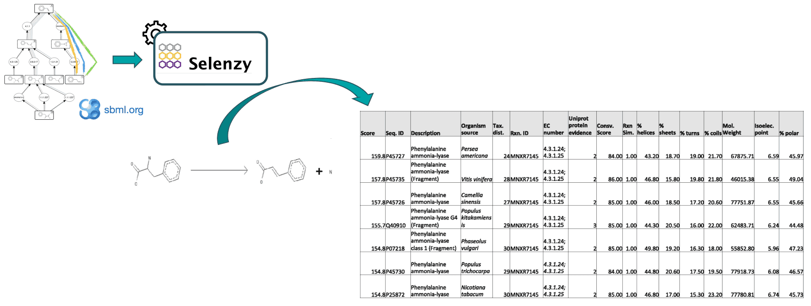
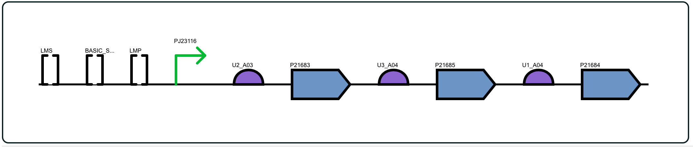
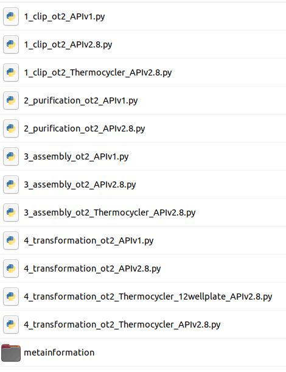
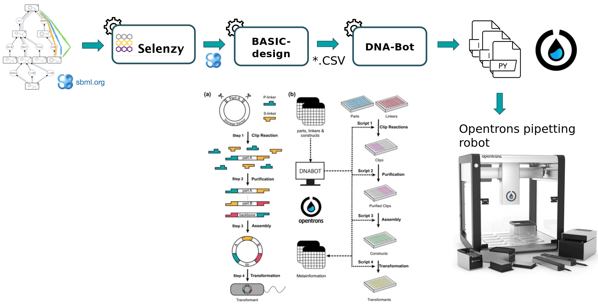

# Tutorial — Genetic Design

Synthetic biology is a novel engineering discipline which requires computational tools for the design of metabolic pathways for the production of chemicals such as SynBioCAD portal which is the first Galaxy set of tools for synthetic biology and metabolic engineering[@herisson2022].

In this tutorial, we will use a set of tools from the **Genetic Design - BASIC Assembly Workflow** ([https://galaxy-synbiocad.org](https://galaxy-synbiocad.org) which will enable you to design plasmids implementing metabolic pathways for the bioproduction of lycopene in _E.coli_ (one of the preferred host cell for microbial biochemicals production).

Lycopene is a potent antioxidant and has been widely used in the fields of pharmaceuticals, nutraceuticals, and cosmetics. It's widely found in fruits including tomato, watermelon, guava, and papaya but the extraction method of lycopene from these natural sources is expensive, complicated and cannot match the large market demand.

<figure class="numbered" markdown>
  { width="400" }
  <figcaption markdown>Lycopene chemical structure</figcaption>
</figure>

To address this demand, synthetic biology and metabolic engineering have been employed to develop microbial cell factories (e.g. _E.coli_ strains) for lycopene production.

To design plasmids encoding lycopene bioproducing pathways, we will use the BASIC assembly method[@storch2015] which relies on orthogonal linkers and type IIs restriction enzyme cleavage to provide a robust and accurate assembly of DNA parts into plasmid constructs. From these construct definition, the workflow will generate scripts enabling the automatic build of the plasmids as well as the transformation of strains using an Opentrons liquid handler robot. After downloading these scripts onto a computer connected to an Opentrons, one can perform the automated construction of the plasmids at the bench.

The workflow scheme we will use is shown below. First, we will run the steps of this workflow individually so as not to neglect the understanding of the intermediate steps as well. Then, we will run the workflow automatically so that it itself retrieves the outputs from the previous step and gives them as input to the next tool.

<figure class="numbered" markdown>
  { width="720" }
  <figcaption markdown>Genetic Design - BASIC Assembly Workflow</figcaption>
</figure>

## Data Preparation

First we need to upload and prepare the following inputs to analyze:

- One SBML (Systems Biology Markup Language) file modeling a heterologous pathway producing lycopene such as those produced by the Pathway Analysis Workflow [https://galaxy-synbiocad.org](https://galaxy-synbiocad.org).

- The `parts_for_lycopene.csv` file listing the parts to be used (linkers, backbone and promoters) in the constructions.

- Two YAML files providing two examples of settings, i.e. providing the identifiers of the laboratory equipment and the parameters to be used in the Opentrons scripts.

!!! example "How-to: Data Preparation"
    1. Create a new history named **`Genetic Design - Lycopene`**.

        Details: [Creating a New History — Galaxy FAQ](https://training.galaxyproject.org/training-material/faqs/galaxy/#tip-creating-a-new-history)

    2. Import the input files from Zenodo:
       ```
       https://zenodo.org/record/6123887/files/dnabot_paris_settings.yaml
       https://zenodo.org/record/6123887/files/dnabot_london_settings.yaml
       https://zenodo.org/record/6123887/files/parts_for_lycopene.csv
       https://zenodo.org/record/6123887/files/rp_002_0011.xml
       ```

    3. Rename the datasets:

        | Current name                      | New name                          |
        |-----------------------------------|-----------------------------------|
        | **`dnabot_paris_settings.yaml`**  | **`DNABOT Paris Settings`**       |
        | **`dnabot_london_settings.yaml`** | **`DNABOT London Settings`**      |
        | **`parts_for_lycopene.csv`**      | **`Lycopene Parts`**              |
        | **`rp_002_0011.xml`**             | **`Lycopene Predicted Pathway`**  |

## Genetic Design Steps

### Find enzymes using **Selenzyme**

At first, a pathway generated by the **Pathway Analysis workflow** ([https://galaxy-synbiocad.org](https://galaxy-synbiocad.org)) is provided as input to the Selenzyme tool[@carbonell2018]. Selenzyme searches for enzymes corresponding to each reaction of the pathway. It performs a reaction similarity search in the reference reaction database [MetaNetX](https://www.metanetx.org) and outputs an updated SBML file annotated with the enzyme UniProt IDs.

The tool provides several scores that can be combined in order to define an overall score. Scores are given for reaction similarity, conservation based on a multiple sequence alignment, phylogenetic distance between source organism and host, and additional scores calculated from sequence properties as shown in the example bellow.

<figure class="numbered" markdown>
  { width="720" }
  <figcaption markdown>Selenzyme concepts</figcaption>
</figure>

!!! example "Hands-on: Annotate enzymes with Uniprot IDs"
    Run {{ icon("gx-tool") }}**Selenzyme** ({{ icon("gx-tool-version") }}Galaxy Version 0.2.0)) with parameters:

    - Select **Pathway**:
        - **Single dataset** input {{ icon("gx-param-file") }}
        - Dataset {{ icon("gx-history-input") }} **`Lycopene Predicted Pathway`**
    - In **Advanced Options** {{ icon("gx-eye") }}:
        - **Host taxon ID**: Leave the default value **`83333`**. This stands for using E. coli as the chassis host.
        - **Comma separated taxon IDs of output enzyme sequences**: use **`553`** which is the taxon ID of _Pantoea ananatis_ strain from which we want to extract enzymes.
        - **Other options**: Leave all other options at their default values.

    !!! question "Q1: How are identified the enzyme in the CSV file?"
        
        Enzyme are identified by their UniProt ID
        
        ```text
        ```
        

    !!! question: "Q2: According to the tabulated file, how many enzymes were found for each reaction?"
        
        Two for each reaction.
        
        ```text
        ```
        

!!! example "Hands-on: Rename outputs"
    Rename the outputs of **Selenzyme** {{ icon("gx-tool") }} to more meaningful names:

    | Current name                      | New name                             |
    |-----------------------------------|--------------------------------------|
    | **`Uniprot IDs`** (XML)           | **`Lycopene Pathway with Enzymes`**  |
    | **`Uniprot IDs`** (CSV)           | **`Candidate Enzymes`**              |

### Generate constructs using **BasicDesign**

**BasicDesign** extracts enzyme IDs contained in the annotated pathway and generate genetic constructs compliant with the BASIC assembly approach. It requires as input an SBML with enzyme IDs for each reaction, and optionally one or several CSV files listing by their IDs the linkers, the promoters and the backbone used (**`Lycopene Parts`**). Example, below:

    ```txt
    id,type,sequence,comment
    L1,neutral linker,,
    L2,neutral linker,,
    L3,neutral linker,,
    ```

For **linkers**, the type annotation should be one of _neutral linker_, _methylated linker_, _peptide fusion linker_ or _RBS linker_. For **user parts**, type should be one of _backbone_ or _constitutive promoter_. Other type will raise a warning and will be omited.

**BasicDesign** converts the SBML file into CSV files describing the DNA-parts to be included into each construct (in an operon format, i.e. with only one promoter) and enumerate possible combinations of promoters, RBSs and enzymes into constructs. Depending on the numbers of enzymes per reaction, of RBSs and promoters available, and whether or not to perform CDS permutation within the operon, the number of constructs may vary.

!!! example "Hands-on: Design genetic constructs"
    Run {{ icon("gx-tool") }}**BasicDesign** ({{ icon("gx-tool-version") }}Galaxy Version 0.3.4) with parameters:

    - Select **Pathway (SBML)**:
        - **Single dataset** input {{ icon("gx-param-file") }}
        - Dataset {{ icon("gx-history-input") }} **`Lycopene Pathway with Enzymes`**
    - Set **Backbone part ID**: leave as default **`BASIC_SEVA_37_CmR-p15A.1`**
    - Set **Number of constructs**: leave as default **`88`**
    - In **Advanced Options** {{ icon("gx-eye") }}:
        - Select **Linkers and user parts**:
            - **Multiple datasets** input {{ icon("gx-param-files") }}
            - Select **`Lycopne Parts`**
        - **LMS/LMP** part IDs: leave as default **`LMS`** and **`LMP`**
        - Toggle **Perform CDS permutation** {{ icon("gx-param-toggle-off") }}: **`Yes`**

    !!! info "Outputs"
        The tool will output four datasets:
        - A CSV file listing all the constructs with the DNA-parts IDs to be used for. Each row corresponds to one construct, and consists of a sequence of BASIC linker and DNA part IDs.
        - A CSV file listing the BASIC linkers to be used with their plate coordinates
        - A CSV file listing the DNA-parts to be used with their plate coordinates
        - A collection of SBOL files (one per construct) that can be visualized using online tools such as [VisBOL](https://visbol.org/).
    
    ??? question "Q1: How many constructs were generated?"
        
        88 construct designs were generated in CSV and SBOL format.
        
        ```text
        ```
        

    ??? question "Q2: Visualize one SBOL construct using VisBOL. What do you observe?"
        
        The construct is composed of the backbone, a promoter, a series of enzyme-encoding genes separated by linkers, and flanked by the LMP and LMS linkers.

        <figure class="numbered" markdown>
          { width="600" }
          <figcaption markdown>BASIC construct rendered with VisBOL</figcaption>
        </figure>
        
        ```text
        ```
        

!!! example "Hands-on: Rename outputs"
    Rename the outputs of **BasicDesign** {{ icon("gx-tool") }}:

    | Current name                      | New name                          |
    |-----------------------------------|-----------------------------------|
    | **`Constructs`** (CSV)            | **`BASIC - Constructs`**         |
    | **`User parts plate`** (CSV)      | **`BASIC - User Parts Plate`**   |
    | **`Biolegio plate`** (CSV)        | **`BASIC - Linkers Plate`**      |
    | **`Constructs`** (Collection)     | **`BASIC - Constructs SBOL`**    |

### Generating pipetting robot instructions using **DNA-Bot**

DNA-Bot tool[@storch2020] reads the list of constructs (previously produced by BasicDesign) and the DNA-parts position on the source plates and generates a set of python scripts to drive an Opentrons liquid handling robot for building the the plasmids. Optional parameters can be set by the user to define the plastic labwares to be used, and set protocol parameters such as washing or incubation times for purification step (**`DNABOT Paris Settings`** YAML file).

!!! example "Hands-on: Generate DNA-Bot scripts"
    Run {{ icon("gx-tool") }}**DNA-Bot** ({{ icon("gx-tool-version") }}Galaxy Version 3.1.0) with parameters:

    - Select **Source Construct**:
        - **Single dataset** input {{ icon("gx-param-file") }}
        - Dataset {{ icon("gx-history-input") }} **`BASIC - Constructs`** (CSV )
    - Select **Plate files**:
        - **Multiple datasets** input {{ icon("gx-param-files") }}
        - Select these two datasets: **`BASIC - User Parts Plate`** and **`BASIC - Linkers Plate`** (hold **Ctrl** or **Cmd** key to select multiple datasets)
    - In **Advanced Options** {{ icon("gx-eye") }}:
        - **Lab Setting**:
            - **Single dataset** input {{ icon("gx-param-file") }}
            - Dataset {{ icon("gx-history-input") }} **`DNABOT Paris Settings`** or **`DNABOT London Settings`** (YAML file)
        - Leave other options at their default values.

    !!! info "Outputs"
        This tool will output DNA-Bot scripts in tar format. You need to download it and decompress the archive. After downloading these scripts onto a computer connected to an Opentrons, one can perform the automated construction of the plasmids at the bench. Additional metadata meaningful to keep track of parameters are also outputted by the tool.

        <figure class="numbered" markdown>
          { width="360" }
          <figcaption markdown>Content of the TAR file generated by DNA-Bot</figcaption>
        </figure>

    ??? question "Q1: Looking at the scripts names, can you figure out the 4 main steps of DNA-Bot?"
        
        Main steps:
        1. **Clip reactions**: Prepare the mixes for the ligation of the individual DNA parts with the linkers.
        2. **Purification**: Purify the linker-ligated DNA parts using magnetic beads and the Opentrons magnetic module.
        3. **Assembly**: Mix the DNA purified parts to build the final constructs.
        4. **Transformation**: Transform the chassis micro-organism with the plasmid and inoculate onto agar.
        
        ```text
        ```
        

    ??? question "Q2: What is the format of the scripts?"
        
        The scripts are in Python format (.py).
        
        ```text
        ```
        

## Conclusion

In this tutorial, we have designed plasmids for the production of lycopene in _E.coli_ using the BASIC assembly method. We have used three tools from the Galaxy-SynBioCAD portal: **Selenzyme** to identify enzymes for each reaction of the pathway, **BasicDesign** to generate genetic constructs compliant with the BASIC assembly method, and **DNA-Bot** to generate scripts for an Opentrons liquid handling robot to automate the plasmid construction.

From there one can follow the [DNA-Bot protocol](https://openwetware.org/wiki/DNA-BOT_Protocol) to perform the automated construction of the plasmids at the bench.
<figure class="numbered" markdown>
  { width="600" }
  <figcaption markdown>Content of the TAR file generated by DNA-Bot</figcaption>
</figure>

## References

\bibliography
